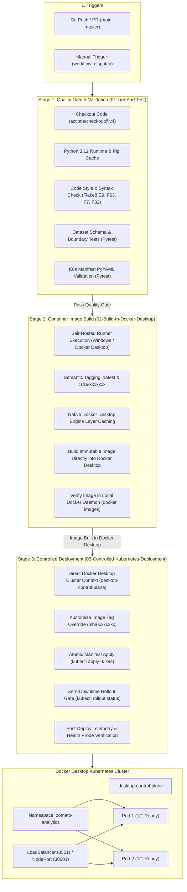

# Production CI/CD Pipeline Architecture: GitHub Actions to Kubernetes

This document provides complete architectural specifications, workflow blueprints, and operational runbooks for the automated **Continuous Integration and Continuous Deployment (CI/CD)** pipeline powering the **Zomato Analytics Platform**.

---

## 1. End-to-End Pipeline Architecture

The CI/CD pipeline automates the full path from developer commit to live cluster rollout across 3 deterministic stages:



---

## 2. Pipeline Stage Breakdown

### Stage 1: Quality Gate & Automated Validation (`01-Lint-And-Test`)
* **Environment**: `ubuntu-latest`, Python `3.12` with cached pip wheels.
* **Flake8 Linter**: Scans for fatal Python errors (E9 syntax errors, F63/F7 invalid code constructs, F82 undefined names).
* **Automated Data Validation (`tests/test_data_validation.py`)**:
  * Asserts presence and integrity of `zomato_clean_validated.csv`.
  * Enforces schema columns: `name`, `votes`, `location`, `rest_type`, `cuisines`, `rating`, `approx_cost_inr`, `has_online_order`, `has_table_booking`, `price_tier`.
  * Verifies numerical boundaries (ratings $\in [1.0, 5.0]$, votes $\ge 0$, costs $> 0$).
  * Validates executive KPI summary tables (`kpi_summary_channel.csv`, `kpi_summary_executive.csv`, `kpi_summary_price_tier.csv`).
* **Manifest Structural Integrity (`tests/test_k8s_manifests.py`)**:
  * Parses all YAML manifests in `k8s/` using `PyYAML`.
  * Enforces container port `8501`, non-root user `appuser` (UID `1000`), resource requests/limits, and triple health probes (`startupProbe`, `livenessProbe`, `readinessProbe`).

### Stage 2: Container Image Build in Docker Desktop (`02-Build-In-Docker-Desktop`)
* **Environment**: `self-hosted` runner running directly on the host machine connected to Docker Desktop.
* **Docker Daemon**: Interacts directly with Docker Desktop engine without network hops.
* **Tagging Strategy**:
  * Dual-tagging: `zomato-analysis-dashboard:latest` + `zomato-analysis-dashboard:sha-<7-char-commit-hash>` for deterministic version tracking and instant rollbacks.
* **Build Acceleration**: Leverages local Docker layer caching for ultra-fast rebuilds (< 5 seconds).

### Stage 3: Controlled Kubernetes Deployment (`03-Controlled-Kubernetes-Deployment`)
* **Environment**: `self-hosted` runner with native `kubectl` access to Docker Desktop Kubernetes cluster.
* **Gated Execution**: Runs automatically on pushes to `main` and manual triggers (`workflow_dispatch`).
* **Dynamic Image Patching**: Sets container image to the exact `sha-xxxxxxx` tag freshly built in Docker Desktop.
* **Zero-Downtime Rolling Update**:
  * Manifest apply: `kubectl apply -k k8s`
  * Rollout verification gate:
    ```bash
    kubectl rollout status deployment/zomato-dashboard -n zomato-analytics --timeout=120s
    ```
  * Health verification against live pod endpoint `http://localhost:8501/_stcore/health`.

---

## 3. Repository File Structure

```
data_analysis/
├── .github/
│   └── workflows/
│       └── ci-cd.yml             # GitHub Actions CI/CD Pipeline definition
├── tests/
│   ├── test_data_validation.py   # Dataset schema, data types & KPI tests
│   └── test_k8s_manifests.py     # Kubernetes manifest structure & probe tests
├── k8s/
│   ├── namespace.yaml            # Isolated zomato-analytics namespace
│   ├── configmap.yaml            # Application configuration & theme
│   ├── deployment.yaml           # Deployment spec (2 replicas, probes, security)
│   ├── service.yaml              # LoadBalancer (8501) & NodePort (30501)
│   ├── hpa.yaml                  # Horizontal Pod Autoscaler
│   └── kustomization.yaml        # Kustomize manifest bundle
├── Dockerfile                    # Multi-stage, non-root Streamlit container
├── deploy-k8s.ps1                # Automated Windows PowerShell deployment pipeline
├── deploy-k8s.sh                 # Automated Linux/macOS deployment pipeline
├── requirements.txt              # Application runtime dependencies
├── requirements-dev.txt          # CI/CD and testing dependencies
├── zomato_clean_validated.csv    # Clean production dataset
└── CICD_PIPELINE.md              # Pipeline architecture and runbook
```

---

## 4. GitHub Secret Configuration for Remote Deployment

To connect your remote GitHub Actions workflow to a reachable Kubernetes training cluster:

1. Obtain your cluster's kubeconfig file.
2. Encode the kubeconfig in base64:
   ```powershell
   # Windows PowerShell:
   [Convert]::ToBase64String([System.IO.File]::ReadAllBytes("$HOME\.kube\config"))
   ```
   ```bash
   # Linux/macOS:
   cat ~/.kube/config | base64 -w 0
   ```
3. Navigate to **GitHub Repository** -> **Settings** -> **Secrets and variables** -> **Actions**.
4. Click **New repository secret**:
   * **Name**: `KUBECONFIG`
   * **Value**: Paste the base64-encoded string.

---

## 5. Local Training Cluster Deployment Runbook

You can trigger the entire end-to-end pipeline locally on the reachable training cluster at any time:

### Using Windows PowerShell
```powershell
# Full release: Runs Quality Gate (Flake8 + Pytest), builds image, applies K8s manifests, and verifies rollout:
.\deploy-k8s.ps1

# With browser auto-launch and port-forwarding:
.\deploy-k8s.ps1 -PortForward

# Skip build if using existing cached image:
.\deploy-k8s.ps1 -SkipBuild
```

### Using Linux / WSL / macOS
```bash
chmod +x deploy-k8s.sh
./deploy-k8s.sh
```

---

## 6. Verification and Health Checks

### Check Rollout Status
```powershell
kubectl rollout status deployment/zomato-dashboard -n zomato-analytics
```

### View Running Pods and IP Addresses
```powershell
kubectl get pods -n zomato-analytics -o wide
```

### View Services and Port Bindings
```powershell
kubectl get svc -n zomato-analytics
```

### Query Application Health Endpoint Directly
```powershell
curl http://localhost:8501/_stcore/health
# Returns: "ok" (HTTP 200)
```

---

## 7. Emergency Rollback Runbook

If a faulty release is applied to the cluster, execute an instant zero-downtime rollback:

```powershell
# 1. View deployment revision history:
kubectl rollout history deployment/zomato-dashboard -n zomato-analytics

# 2. Roll back to the previous stable revision:
kubectl rollout undo deployment/zomato-dashboard -n zomato-analytics

# 3. Monitor rollback completion:
kubectl rollout status deployment/zomato-dashboard -n zomato-analytics
```
