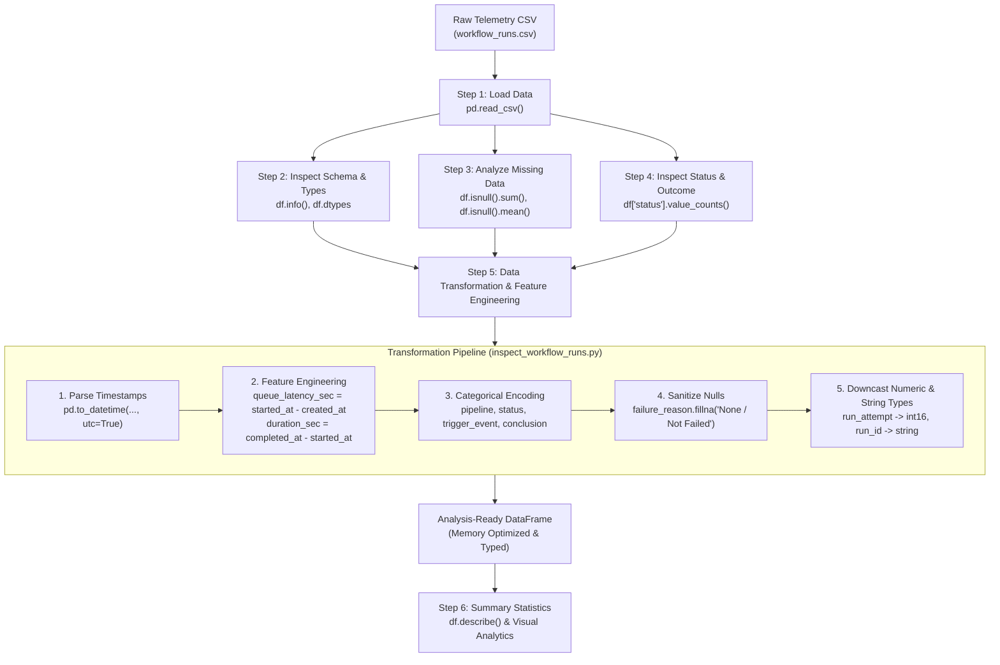

# Telemetry Data Ingestion & Transformation: Raw to Analysis-Ready DataFrame

This document explains the end-to-end data pipeline implemented in [`inspect_workflow_runs.py`](file:///d:/Akarsh/Mysore_pythonDocker/data_analysis/inspect_workflow_runs.py), which ingests raw telemetry records from [`workflow_runs.csv`](file:///d:/Akarsh/Mysore_pythonDocker/data_analysis/workflow_runs.csv) and transforms them into an optimized, analysis-ready pandas DataFrame.

---

## 1. Workflow Architecture Diagram

The diagram below illustrates the end-to-end transformation workflow from raw CSV ingestion through inspection, data cleaning, feature engineering, and final analytical output:



---

## 2. Step-by-Step Code Explanation

### Step 1: Loading Raw Telemetry CSV
```python
df_raw = pd.read_csv(csv_path)
```
- **What it does:** Reads comma-separated values from the disk into memory as an initial pandas `DataFrame`.
- **Why it matters:** At this stage, pandas infers types heuristically: strings and ISO timestamps are loaded as generic `object` types, and IDs with numeric values are inferred as `int64`.

---

### Step 2: Schema & Data Type Inspection
```python
df_raw.info()
print(df_raw.dtypes)
```
- **What it does:** Prints the total row count, column names, non-null counts, and data types (`dtypes`), as well as memory consumption.
- **Key Observation:**
  - `created_at`, `started_at`, and `completed_at` are stored as plain string `object` types, meaning date arithmetic and filtering cannot yet be performed.
  - Low-cardinality discrete columns (e.g., `pipeline`, `status`) consume excessive memory as generic Python objects.

---

### Step 3: Analyzing Missing Data (Null Values)
```python
missing_summary = pd.DataFrame({
    'Missing Values': df_raw.isnull().sum(),
    'Percentage (%)': (df_raw.isnull().mean() * 100).round(2)
})
```
- **What it does:** Quantifies missing data across every column both by absolute count and by percentage.
- **Telemetry-Specific Null Patterns:**
  - **Structural Nulls (Expected):** Workflows currently in `in_progress` or `queued` status have null `completed_at` and null `conclusion`. These are valid business states and should **not** be dropped.
  - **Conditional Nulls (Expected):** `failure_reason` is populated only when `conclusion == 'failure'`. Successful and active runs legitimately have `NaN`.
  - **Sensor/Metric Drops (Unplanned):** Missing `cpu_utilization_pct` in completed runs indicates telemetry reporting gaps from the worker agent.

---

### Step 4: Inspecting Status & Conclusion Values
```python
print(df_raw['status'].value_counts(dropna=False))
print(df_raw['conclusion'].value_counts(dropna=False))
print(df_raw['trigger_event'].value_counts(dropna=False))
```
- **What it does:** Calculates frequency distributions for discrete operational states.
- **Why it matters:** 
  - Verifies data consistency between lifecycle states (`status`: `completed`, `in_progress`, `queued`) and terminal outcomes (`conclusion`: `success`, `failure`, `cancelled`, `timed_out`).
  - Including `dropna=False` ensures in-flight jobs without a conclusion are visible.

---

### Step 5: Transforming Raw Data to Analysis-Ready DataFrame

This is the core cleaning and feature engineering step:

#### 1. Datetime Parsing with UTC Standardization
```python
timestamp_cols = ['created_at', 'started_at', 'completed_at']
for col in timestamp_cols:
    df_clean[col] = pd.to_datetime(df_clean[col], errors='coerce', utc=True)
```
- Converts ISO 8601 strings into timezone-aware `datetime64[us, UTC]`.
- Enables time delta operations and time-series aggregation.

#### 2. Feature Engineering: Latency & Duration
```python
# Queue latency: wait time before execution starts in seconds
df_clean['queue_latency_sec'] = (df_clean['started_at'] - df_clean['created_at']).dt.total_seconds()

# Execution duration: active run time in seconds
df_clean['duration_sec'] = (df_clean['completed_at'] - df_clean['started_at']).dt.total_seconds()
```
- `queue_latency_sec`: Measures runner availability and queuing delays.
- `duration_sec`: Quantifies true workload runtime, excluding queuing time.

#### 3. Categorical Encoding for Low-Cardinality Fields
```python
cat_cols = ['pipeline', 'trigger_event', 'status', 'conclusion']
for col in cat_cols:
    df_clean[col] = df_clean[col].astype('category')
```
- Replaces heavy string pointers with compact integer category codes.
- Dramatically lowers memory usage and speeds up `groupby()` operations.

#### 4. Handling Conditional Nulls
```python
df_clean['failure_reason'] = df_clean['failure_reason'].fillna('None / Not Failed')
```
- Replaces `NaN` with an explicit label so text filtering and grouping don't ignore successful runs.

#### 5. ID & Numeric Type Casting
```python
df_clean['run_id'] = df_clean['run_id'].astype('string')
df_clean['run_attempt'] = df_clean['run_attempt'].astype('int16')
```
- Casts `run_id` to `string` so mathematical aggregations (e.g. `mean()`, `sum()`) are not accidentally computed on identifiers.
- Downcasts `run_attempt` from 64-bit to 16-bit integers (`int16`), saving memory.

---

### Step 6: Summary Telemetry Statistics
```python
numeric_summary = df_clean[['queue_latency_sec', 'duration_sec', 'cpu_utilization_pct', 'memory_used_mb']].describe().round(2)
print(numeric_summary)
```
- **What it does:** Computes descriptive statistics (count, mean, standard deviation, quartiles, min, max) for numeric performance metrics.
- **Application:** Identifies bottlenecks, runtime outliers, and resource usage anomalies.

---

## 3. Data Schema: Before vs. After

| Column Name | Raw Dtype | Analysis-Ready Dtype | Optimization Rationale |
| :--- | :--- | :--- | :--- |
| `run_id` | `int64` | `string` | Identifier, prevents numeric math |
| `workflow_name` | `object` | `string` | Text string |
| `pipeline` | `object` | `category` | Low cardinality category |
| `trigger_event` | `object` | `category` | Low cardinality category |
| `status` | `object` | `category` | Low cardinality lifecycle state |
| `conclusion` | `object` | `category` | Low cardinality outcome |
| `created_at` | `object` | `datetime64[us, UTC]` | Timezone-aware timestamp |
| `started_at` | `object` | `datetime64[us, UTC]` | Timezone-aware timestamp |
| `completed_at` | `object` | `datetime64[us, UTC]` | Timezone-aware timestamp |
| `run_attempt` | `int64` | `int16` | Downcasted integer |
| `cpu_utilization_pct`| `float64` | `float64` | Performance metric ($0.0 - 100.0$) |
| `memory_used_mb` | `float64` | `float64` | Memory metric in MB |
| `failure_reason` | `object` | `string` | Conditional text with explicit fill |
| `queue_latency_sec` | *(new)* | `float64` | Derived queue wait duration |
| `duration_sec` | *(new)* | `float64` | Derived active execution duration |

---

## 4. How to Run the Pipeline

Execute the script from the project folder:

```powershell
python inspect_workflow_runs.py
```
