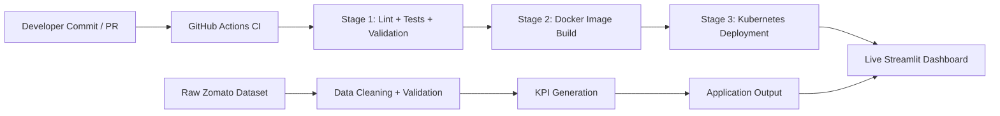

# Zomato Analytics Platform

This repository implements a full data-to-deployment workflow for the Zomato analytics application: raw dataset ingestion, data validation, KPI generation, containerization, and automated deployment through a CI/CD pipeline. The primary project flow is no longer just the application itself; it is the end-to-end delivery pipeline from code commit to running Kubernetes deployment.

---

## 1. Project Workflow: From Code to Production



### End-to-End Pipeline

1. Source code is committed to the repository.
2. GitHub Actions triggers the CI workflow.
3. Quality gates run: linting, test validation, schema checks, and Kubernetes manifest confirmation.
4. A Docker image is built from the application and packaged with the validated dataset and runtime dependencies.
5. The image is pushed and deployed to the Kubernetes cluster through the controlled rollout process.
6. The Streamlit dashboard becomes available to users from the live cluster.

---

## 2. CI/CD Pipeline Stages

### Stage 1: Quality Gate and Validation
The workflow runs automated checks before deployment:

- Python linting and syntax validation
- Dataset validation for schema, boundaries, and KPI output
- Kubernetes manifest verification with YAML parsing and structural checks
- Test suite execution for application integrity and deployment readiness

This stage ensures that code quality and production artifacts are valid before a release proceeds.

### Stage 2: Container Build
Once validation passes, the application is built into a container image using the project Dockerfile. The build is performed in the Docker Desktop environment with versioned tags for traceability and rollback.

### Stage 3: Controlled Deployment
The deployment stage applies the Kubernetes manifests and performs rollout verification before declaring the release successful. This ensures the app is not only built, but also actually healthy in the target cluster.

---

## 3. Repository Flow by Function

The project combines analytics processing and deployment automation in one repository:

- [`inspect_zomato.py`](inspect_zomato.py): raw dataset inspection and transformation logic
- [`clean_and_validate.py`](clean_and_validate.py): cleaning, validation, and dataset export
- [`kpi_summary.py`](kpi_summary.py): business KPI generation
- [`tests/`](tests): CI validation checks for data and manifests
- [`k8s/`](k8s): Kubernetes deployment manifests
- [`Dockerfile`](Dockerfile): application containerization
- [`.github/workflows/ci-cd.yml`](.github/workflows/ci-cd.yml): GitHub Actions pipeline definition
- [`deploy-k8s.ps1`](deploy-k8s.ps1) and [`deploy-k8s.sh`](deploy-k8s.sh): deployment scripts for cluster rollout

---

## 4. Data and Application Workflow

The project workflow includes both the analytics pipeline and the release pipeline:

1. Raw data is loaded from the source CSV.
2. The data is cleaned, normalized, and validated.
3. KPI outputs are generated for market analysis and business reporting.
4. The validated dataset and application code are packaged into the deployment image.
5. CI validates the code and cluster manifests.
6. CD deploys the containerized application to Kubernetes.

This means the repository is not only an app project; it is a complete operational workflow that turns ingestible raw data into a deployable analytics product.

---

## 5. Local Commands

### Run the data pipeline locally
```powershell
python inspect_zomato.py
python clean_and_validate.py
python kpi_summary.py
```

### Run the validation suite
```powershell
pytest -v tests/
```

### Deploy the project to Kubernetes
```powershell
.\deploy-k8s.ps1
```

---

## 6. CI/CD Documentation

For the full deployment architecture and runbook, see:

- [`CICD_PIPELINE.md`](CICD_PIPELINE.md)
- [`KUBERNETES.md`](KUBERNETES.md)
- [`docker.md`](docker.md)
- [`github.md`](github.md)

---

## 7. Summary

The project now follows a CI/CD-driven delivery model:

- Code is validated before deployment.
- The app is containerized as a reproducible artifact.
- The Kubernetes cluster receives zero-downtime rolled-out updates.
- The analytics workflow and deployment flow are treated as a single production pipeline.

This is the recommended project workflow for the repository and replaces the earlier app-only orientation with a production CI/CD delivery story.
