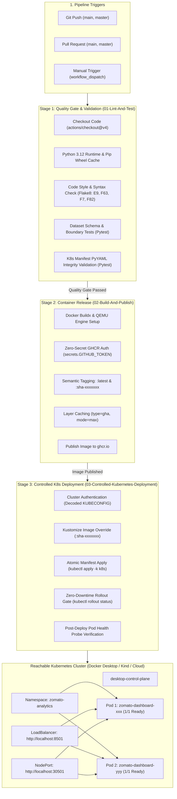

# GitHub & GitHub Actions Manual: CI/CD Pipeline & DevOps Automation

This document provides a comprehensive operational guide and architectural breakdown of **GitHub**, **GitHub Actions**, and the automated **Continuous Integration / Continuous Deployment (CI/CD)** pipeline powering the **Zomato Analytics Intelligence Platform**.

---

## 1. Project Repository Link

* **Official GitHub Repository**: [https://github.com/akarshrajap/dataframe](https://github.com/akarshrajap/dataframe)
* **Default Branch**: `main`
* **Workflow Configuration**: [`.github/workflows/ci-cd.yml`](file:///d:/Akarsh/Mysore_pythonDocker/data_analysis/.github/workflows/ci-cd.yml)
* **Container Registry (GHCR)**: `ghcr.io/akarshrajap/zomato-analysis-dashboard`

---

## 2. What GitHub & GitHub Actions Provide in this Project

```
+---------------------------------------------------------------------------------------------------+
|                                      GITHUB PLATFORM ECOSYSTEM                                     |
+------------------------------------+----------------------------------+---------------------------+
| 1. Source Control & Governance     | 2. GitHub Actions (CI/CD)        | 3. GitHub Container (GHCR)|
| - Distributed Version Control (Git)| - Automated Quality Gate (Test)  | - Docker Image Registry   |
| - Branch Protection & Pull Requests| - Multi-Stage Buildx Automation  | - Versioned Image Tags    |
| - Clean Tracking (.gitignore)      | - Controlled K8s Deployment Gate | - Ephemeral Authentication|
+------------------------------------+----------------------------------+---------------------------+
```

### 1. Source Control & Repository Hygiene
* **Version Control**: Tracks all modifications across application code ([`app.py`](file:///d:/Akarsh/Mysore_pythonDocker/data_analysis/app.py)), data cleaning routines ([`clean_and_validate.py`](file:///d:/Akarsh/Mysore_pythonDocker/data_analysis/clean_and_validate.py)), and Kubernetes manifests ([`k8s/`](file:///d:/Akarsh/Mysore_pythonDocker/data_analysis/k8s)).
* **Repository Cleanliness ([`.gitignore`](file:///d:/Akarsh/Mysore_pythonDocker/data_analysis/.gitignore))**:
  * Prevents committing the oversized ~574 MB raw [`zomato.csv`](file:///d:/Akarsh/Mysore_pythonDocker/data_analysis/zomato.csv) file (exceeding GitHub's 100 MB per-file push limit).
  * Excludes compiled Python artifacts (`__pycache__/`, `*.pyc`), test artifacts (`.pytest_cache/`, `.coverage`), and virtual environments (`venv/`, `.venv/`).

### 2. GitHub Container Registry (GHCR - `ghcr.io`)
* Acts as the centralized, enterprise-grade Docker image registry hosting containerized builds of the application:
  `ghcr.io/akarshrajap/zomato-analysis-dashboard:latest`
* Kubernetes pods pull images directly from GHCR using the declared image specifications in [`k8s/deployment.yaml`](file:///d:/Akarsh/Mysore_pythonDocker/data_analysis/k8s/deployment.yaml).

### 3. GitHub Actions CI/CD Pipeline Automation
* Orchestrates an automated 3-stage pipeline executed on GitHub-hosted Ubuntu runners every time code is pushed or merged into `main`.

---

## 3. End-to-End Pipeline Architecture



---

## 4. Pipeline Stages & Workflow Breakdown

The pipeline configuration resides in [`.github/workflows/ci-cd.yml`](file:///d:/Akarsh/Mysore_pythonDocker/data_analysis/.github/workflows/ci-cd.yml):

### Stage 1: Quality Gate & Validation (`01-Lint-And-Test`)

```yaml
validate-and-test:
  name: 01-Lint-And-Test
  runs-on: ubuntu-latest
  steps:
    - name: Checkout Source Code
      uses: actions/checkout@v4

    - name: Set up Python 3.12
      uses: actions/setup-python@v5
      with:
        python-version: "3.12"
        cache: "pip"

    - name: Install Dependencies
      run: |
        python -m pip install --upgrade pip
        pip install -r requirements-dev.txt

    - name: Code Quality & Syntax Check (Flake8)
      run: |
        flake8 . --count --select=E9,F63,F7,F82 --show-source --statistics

    - name: Automated Data & Manifest Test Suite (Pytest)
      run: |
        pytest -v tests/
```

#### What Happens Here:
1. **Runner Provisioning**: Spins up an ephemeral `ubuntu-latest` virtual machine and checks out the commit.
2. **Python Caching**: Preheats pip dependency cache to minimize runner setup overhead on repeated runs.
3. **Flake8 Syntax Gate**: Scans all Python files for fatal syntax errors (`E9`), invalid code constructs (`F63`, `F7`), and undefined variables (`F82`). Any violation halts the build immediately.
4. **Pytest Suite (`tests/`)**:
   * [`tests/test_data_validation.py`](file:///d:/Akarsh/Mysore_pythonDocker/data_analysis/tests/test_data_validation.py): Verifies presence of [`zomato_clean_validated.csv`](file:///d:/Akarsh/Mysore_pythonDocker/data_analysis/zomato_clean_validated.csv), checks required schema columns, rating bounds $[1.0, 5.0]$, vote non-negativity, cost positivity, boolean flags, and executive KPI summary files.
   * [`tests/test_k8s_manifests.py`](file:///d:/Akarsh/Mysore_pythonDocker/data_analysis/tests/test_k8s_manifests.py): Parses all YAML manifests in [`k8s/`](file:///d:/Akarsh/Mysore_pythonDocker/data_analysis/k8s) using `PyYAML`. Ensures `apiVersion`, `kind`, UID `1000`, port `8501`, resource limits, and triple health probes (`startupProbe`, `livenessProbe`, `readinessProbe`) are valid.

---

### Stage 2: Container Image Build & Publication (`02-Build-And-Publish`)

```yaml
build-and-publish:
  name: 02-Build-And-Publish
  needs: validate-and-test
  runs-on: ubuntu-latest
  permissions:
    contents: read
    packages: write
  outputs:
    image_tag: ${{ steps.set-tag.outputs.IMAGE_TAG }}
  steps:
    - name: Checkout Source Code
      uses: actions/checkout@v4

    - name: Set up Docker Buildx
      uses: docker/setup-buildx-action@v3

    - name: Authenticate to GitHub Container Registry (GHCR)
      uses: docker/login-action@v3
      with:
        registry: ${{ env.REGISTRY }}
        username: ${{ github.actor }}
        password: ${{ secrets.GITHUB_TOKEN }}

    - name: Generate Docker Metadata & Tags
      id: meta
      uses: docker/metadata-action@v5
      with:
        images: ${{ env.REGISTRY }}/${{ env.IMAGE_NAME }}
        tags: |
          type=raw,value=latest,enable={{is_default_branch}}
          type=sha,format=short,prefix=sha-

    - name: Build and Push Docker Image
      uses: docker/build-push-action@v5
      with:
        context: .
        push: ${{ github.event_name != 'pull_request' }}
        tags: ${{ steps.meta.outputs.tags }}
        labels: ${{ steps.meta.outputs.labels }}
        cache-from: type=gha
        cache-to: type=gha,mode=max
```

#### What Happens Here:
1. **Dependency Gate**: Only runs after `validate-and-test` finishes with code 0.
2. **Zero-Secret Authentication**: Uses the ephemeral runner token (`secrets.GITHUB_TOKEN`) with `packages: write` permissions.
3. **Dual Version Tagging**:
   * `:latest`: Always points to the most recent release on the default branch.
   * `:sha-<short-sha>`: Immutable, commit-specific tag (e.g., `:sha-138a98c`) enabling zero-ambiguity traceability and instant rollbacks.
4. **GitHub Actions Layer Caching (`type=gha`)**: Caches unchanged Docker layers between runs, reducing build duration from minutes to seconds.
5. **PR Protection**: For pull requests, images are compiled to verify build integrity but **not pushed** (`push: false`).

---

### Stage 3: Controlled Kubernetes Deployment (`03-Controlled-Kubernetes-Deployment`)

```yaml
deploy-k8s:
  name: 03-Controlled-Kubernetes-Deployment
  needs: build-and-publish
  if: github.ref == 'refs/heads/main' && github.event_name != 'pull_request'
  runs-on: ubuntu-latest
  steps:
    - name: Checkout Source Code
      uses: actions/checkout@v4

    - name: Set up Kubectl CLI
      uses: azure/setup-kubectl@v4

    - name: Configure Kubernetes Cluster Authentication
      run: |
        mkdir -p $HOME/.kube
        if [ -n "${{ secrets.KUBECONFIG }}" ]; then
          echo "${{ secrets.KUBECONFIG }}" | base64 --decode > $HOME/.kube/config
          chmod 600 $HOME/.kube/config
        fi

    - name: Update Deployment Image Tag via Kustomize
      run: |
        TARGET_IMAGE="${{ env.REGISTRY }}/${{ env.IMAGE_NAME }}:${{ needs.build-and-publish.outputs.image_tag }}"
        cd k8s
        if command -v kustomize &> /dev/null; then
          kustomize edit set image zomato-analysis-dashboard:latest="${TARGET_IMAGE}"
        else
          sed -i "s|image: zomato-analysis-dashboard:latest|image: ${TARGET_IMAGE}|g" deployment.yaml
        fi

    - name: Controlled Deployment Apply & Rollout Status
      run: |
        if [ -f "$HOME/.kube/config" ] && [ -s "$HOME/.kube/config" ]; then
          kubectl apply -k k8s
          kubectl rollout status deployment/${{ env.DEPLOYMENT_NAME }} -n ${{ env.NAMESPACE }} --timeout=120s
          kubectl get pods -n ${{ env.NAMESPACE }} -o wide
          kubectl get svc -n ${{ env.NAMESPACE }}
        else
          kubectl kustomize k8s > /dev/null
        fi
```

#### What Happens Here:
1. **Branch Gate**: Restricts production deployments strictly to pushes targeting `main`.
2. **Cluster Authentication**: Decodes the base64-encoded `KUBECONFIG` secret into the runner's `$HOME/.kube/config`.
3. **Dynamic Image Pinning**: Updates the deployment manifest image tag to the exact commit SHA published in Stage 2.
4. **Controlled Apply**: Applies all resources via `kubectl apply -k k8s`.
5. **Rollout Status Gate**: Executes `kubectl rollout status` with a 120s timeout budget, guaranteeing that the pipeline only succeeds when all pods pass startup and readiness probes.

---

## 5. Setting Up Remote Cluster Authentication in GitHub

To link your remote GitHub Actions workflow with your reachable training cluster:

### Step 1: Base64-Encode Your Kubeconfig
```powershell
# In Windows PowerShell:
[Convert]::ToBase64String([System.IO.File]::ReadAllBytes("$HOME\.kube\config"))
```

### Step 2: Store in GitHub Repository Secrets
1. Navigate to your repository: [https://github.com/akarshrajap/dataframe](https://github.com/akarshrajap/dataframe)
2. Go to **Settings** $\rightarrow$ **Secrets and variables** $\rightarrow$ **Actions**.
3. Click **New repository secret**.
4. Set:
   * **Name**: `KUBECONFIG`
   * **Secret**: Paste the base64 string from Step 1.
5. Click **Add secret**.

---

## 6. Local Training Cluster Automation Runbook

You can execute the entire CI/CD pipeline flow locally at any time:

### PowerShell (Windows)
```powershell
# Full release: Runs Flake8 + Pytest, builds Docker image, applies K8s, and verifies rollout:
.\deploy-k8s.ps1

# With browser auto-launch and port-forwarding:
.\deploy-k8s.ps1 -PortForward

# Run tests only:
pytest -v tests/
```

### Bash (Linux / WSL / macOS)
```bash
chmod +x deploy-k8s.sh
./deploy-k8s.sh
```

---

## 7. Cluster Health & Rollback Commands

### Verify Running Pods and Endpoints
```powershell
# Check pod status:
kubectl get pods -n zomato-analytics -o wide

# Check services:
kubectl get svc -n zomato-analytics

# Query health probe endpoint:
curl http://localhost:8501/_stcore/health
# Returns: "ok" (HTTP 200)
```

### Zero-Downtime Rollback
If any deployment requires an immediate rollback to the previous stable release:
```powershell
# View revision history:
kubectl rollout history deployment/zomato-dashboard -n zomato-analytics

# Undo rollout:
kubectl rollout undo deployment/zomato-dashboard -n zomato-analytics

# Monitor rollback status:
kubectl rollout status deployment/zomato-dashboard -n zomato-analytics
```
