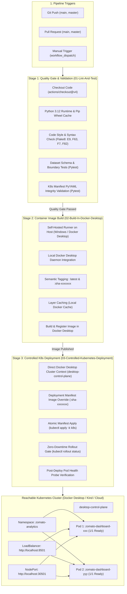

# GitHub & GitHub Actions Manual: CI/CD Pipeline & DevOps Automation

This document provides a comprehensive operational guide and architectural breakdown of **GitHub**, **GitHub Actions**, and the automated **Continuous Integration / Continuous Deployment (CI/CD)** pipeline powering the **Zomato Analytics Intelligence Platform**.

---

## 1. Project Repository Link

* **Official GitHub Repository**: [https://github.com/akarshrajap/dataframe](https://github.com/akarshrajap/dataframe)
* **Default Branch**: `main`
* **Workflow Configuration**: [`.github/workflows/ci-cd.yml`](file:///d:/Akarsh/Mysore_pythonDocker/data_analysis/.github/workflows/ci-cd.yml)
* **Container Registry (GHCR)**: `ghcr.io/akarshrajap/zomato-analysis-dashboard`

---

## 2. What GitHub & GitHub Actions Provide in this Project

```
+---------------------------------------------------------------------------------------------------+
|                                      GITHUB PLATFORM ECOSYSTEM                                     |
+------------------------------------+----------------------------------+---------------------------+
| 1. Source Control & Governance     | 2. GitHub Actions (CI/CD)        | 3. GitHub Container (GHCR)|
| - Distributed Version Control (Git)| - Automated Quality Gate (Test)  | - Docker Image Registry   |
| - Branch Protection & Pull Requests| - Multi-Stage Buildx Automation  | - Versioned Image Tags    |
| - Clean Tracking (.gitignore)      | - Controlled K8s Deployment Gate | - Ephemeral Authentication|
+------------------------------------+----------------------------------+---------------------------+
```

### 1. Source Control & Repository Hygiene
* **Version Control**: Tracks all modifications across application code ([`app.py`](file:///d:/Akarsh/Mysore_pythonDocker/data_analysis/app.py)), data cleaning routines ([`clean_and_validate.py`](file:///d:/Akarsh/Mysore_pythonDocker/data_analysis/clean_and_validate.py)), and Kubernetes manifests ([`k8s/`](file:///d:/Akarsh/Mysore_pythonDocker/data_analysis/k8s)).
* **Repository Cleanliness ([`.gitignore`](file:///d:/Akarsh/Mysore_pythonDocker/data_analysis/.gitignore))**:
  * Prevents committing the oversized ~574 MB raw [`zomato.csv`](file:///d:/Akarsh/Mysore_pythonDocker/data_analysis/zomato.csv) file (exceeding GitHub's 100 MB per-file push limit).
  * Excludes compiled Python artifacts (`__pycache__/`, `*.pyc`), test artifacts (`.pytest_cache/`, `.coverage`), and virtual environments (`venv/`, `.venv/`).

### 2. GitHub Container Registry (GHCR - `ghcr.io`)
* Acts as the centralized, enterprise-grade Docker image registry hosting containerized builds of the application:
  `ghcr.io/akarshrajap/zomato-analysis-dashboard:latest`
* Kubernetes pods pull images directly from GHCR using the declared image specifications in [`k8s/deployment.yaml`](file:///d:/Akarsh/Mysore_pythonDocker/data_analysis/k8s/deployment.yaml).

### 3. GitHub Actions CI/CD Pipeline Automation
* Orchestrates an automated 3-stage pipeline executed on GitHub-hosted Ubuntu runners every time code is pushed or merged into `main`.

---

## 3. End-to-End Pipeline Architecture



---

## 4. Pipeline Stages & Workflow Breakdown

The pipeline configuration resides in [`.github/workflows/ci-cd.yml`](file:///d:/Akarsh/Mysore_pythonDocker/data_analysis/.github/workflows/ci-cd.yml):

### Stage 1: Quality Gate & Validation (`01-Lint-And-Test`)

```yaml
validate-and-test:
  name: 01-Lint-And-Test
  runs-on: ubuntu-latest
  steps:
    - name: Checkout Source Code
      uses: actions/checkout@v4

    - name: Set up Python 3.12
      uses: actions/setup-python@v5
      with:
        python-version: "3.12"
        cache: "pip"

    - name: Install Dependencies
      run: |
        python -m pip install --upgrade pip
        pip install -r requirements-dev.txt

    - name: Code Quality & Syntax Check (Flake8)
      run: |
        flake8 . --count --select=E9,F63,F7,F82 --show-source --statistics

    - name: Automated Data & Manifest Test Suite (Pytest)
      run: |
        pytest -v tests/
```

#### What Happens Here:
1. **Runner Provisioning**: Spins up an ephemeral `ubuntu-latest` virtual machine and checks out the commit.
2. **Python Caching**: Preheats pip dependency cache to minimize runner setup overhead on repeated runs.
3. **Flake8 Syntax Gate**: Scans all Python files for fatal syntax errors (`E9`), invalid code constructs (`F63`, `F7`), and undefined variables (`F82`). Any violation halts the build immediately.
4. **Pytest Suite (`tests/`)**:
   * [`tests/test_data_validation.py`](file:///d:/Akarsh/Mysore_pythonDocker/data_analysis/tests/test_data_validation.py): Verifies presence of [`zomato_clean_validated.csv`](file:///d:/Akarsh/Mysore_pythonDocker/data_analysis/zomato_clean_validated.csv), checks required schema columns, rating bounds $[1.0, 5.0]$, vote non-negativity, cost positivity, boolean flags, and executive KPI summary files.
   * [`tests/test_k8s_manifests.py`](file:///d:/Akarsh/Mysore_pythonDocker/data_analysis/tests/test_k8s_manifests.py): Parses all YAML manifests in [`k8s/`](file:///d:/Akarsh/Mysore_pythonDocker/data_analysis/k8s) using `PyYAML`. Ensures `apiVersion`, `kind`, UID `1000`, port `8501`, resource limits, and triple health probes (`startupProbe`, `livenessProbe`, `readinessProbe`) are valid.

---

### Stage 2: Container Image Build in Docker Desktop (`02-Build-In-Docker-Desktop`)

```yaml
build-docker-desktop:
  name: 02-Build-In-Docker-Desktop
  needs: validate-and-test
  runs-on: self-hosted
  defaults:
    run:
      shell: powershell
  outputs:
    image_tag: ${{ steps.set-tag.outputs.IMAGE_TAG }}
  steps:
    - name: Checkout Source Code
      uses: actions/checkout@v4

    - name: Compute Semantic Image Tag
      id: set-tag
      run: |
        $shortSha = ("${{ github.sha }}").Substring(0, 7)
        $imageTag = "sha-$shortSha"
        "IMAGE_TAG=$imageTag" | Out-File -FilePath $env:GITHUB_OUTPUT -Append -Encoding utf8
        Write-Host "Calculated Docker Image Tag: $imageTag"

    - name: Build Image in Docker Desktop Engine
      run: |
        $shortSha = ("${{ github.sha }}").Substring(0, 7)
        $imageTag = "sha-$shortSha"
        docker build `
          -t "${{ env.IMAGE_NAME }}:$imageTag" `
          -t "${{ env.IMAGE_NAME }}:latest" `
          .
        docker images | Select-String "${{ env.IMAGE_NAME }}"
```

#### What Happens Here:
1. **Self-Hosted Runner Integration**: Runs natively on the host workstation via GitHub Actions self-hosted runner (`desktop-docker-runner`).
2. **Direct Docker Desktop Daemon Access**: The build command communicates directly with the local Docker Desktop daemon without intermediate registry uploads or network bottlenecks.
3. **Dual Version Tagging**:
   * `:latest`: Readily available for local rapid testing and Docker Compose workflows.
   * `:sha-<short-sha>`: Deterministic, immutable Git commit SHA tag (e.g., `:sha-54adcbe`) matching the latest repository trigger.
4. **Local Layer Caching**: Leverages Docker Desktop's local build cache for sub-5-second incremental image rebuilds.
5. **Downstream Tag Propagation**: Publishes the short SHA tag as an output parameter (`image_tag`) consumed by the deployment stage.

---

### Stage 3: Controlled Kubernetes Deployment (`03-Controlled-Kubernetes-Deployment`)

```yaml
deploy-k8s:
  name: 03-Controlled-Kubernetes-Deployment
  needs: build-docker-desktop
  if: (github.ref == 'refs/heads/main' || github.ref == 'refs/heads/master' || github.event_name == 'workflow_dispatch') && github.event_name != 'pull_request'
  runs-on: self-hosted
  defaults:
    run:
      shell: powershell
  steps:
    - name: Checkout Source Code
      uses: actions/checkout@v4

    - name: Verify Cluster Connectivity
      run: |
        Write-Host "Verifying connection to Docker Desktop Kubernetes cluster..."
        kubectl cluster-info
        kubectl get nodes

    - name: Apply Kubernetes Manifests & Deploy Image
      run: |
        $targetImage = "${{ env.IMAGE_NAME }}:${{ needs.build-docker-desktop.outputs.image_tag }}"
        Write-Host "Updating deployment target image to: $targetImage"
        (Get-Content k8s/deployment.yaml) -replace 'image: zomato-analysis-dashboard:.*', "image: $targetImage" | Set-Content k8s/deployment.yaml
        Write-Host "Applying Kustomize manifests to cluster..."
        kubectl apply -k k8s
        Write-Host "Awaiting zero-downtime rolling update completion..."
        kubectl rollout status deployment/${{ env.DEPLOYMENT_NAME }} -n ${{ env.NAMESPACE }} --timeout=120s
        kubectl get pods -n ${{ env.NAMESPACE }} -o wide
        kubectl get svc -n ${{ env.NAMESPACE }}

    - name: Application Health Probe Validation
      run: |
        try {
          $response = Invoke-RestMethod -Uri "http://localhost:8501/_stcore/health" -TimeoutSec 5
          Write-Host "Health probe returned: $response"
        } catch {
          Write-Host "Health check response notice: $_"
        }
```

#### What Happens Here:
1. **Branch Gate**: Restricts production deployments strictly to pushes targeting `main` and manual triggers (`workflow_dispatch`). Pull requests execute quality gates and local builds without triggering cluster updates.
2. **Local Cluster Context**: Interacts directly with Docker Desktop's Kubernetes control plane (`desktop-control-plane`) via current context `docker-desktop`.
3. **Atomic Manifest Apply**: Dynamically updates [`k8s/deployment.yaml`](file:///d:/Akarsh/Mysore_pythonDocker/data_analysis/k8s/deployment.yaml) with the freshly built Docker Desktop image tag and applies all manifests via `kubectl apply -k k8s` (ensuring Namespace, ConfigMap, Services, Deployment, and HPA exist).
4. **Zero-Downtime Rolling Update**: The rolling update strategy (`maxSurge: 1, maxUnavailable: 0`) ensures that old pods remain serving traffic until the newly deployed pods pass their `startupProbe` and `readinessProbe`.
5. **Rollout Verification Gate**: `kubectl rollout status` monitors pod readiness with a 120s timeout budget, blocking the pipeline if health checks fail.
6. **Automated Health Check**: Pings `http://localhost:8501/_stcore/health` to confirm end-to-end service delivery.

---

## 5. Self-Hosted Runner Operation & Configuration

The local Docker Desktop CI/CD pipeline runs using GitHub Actions self-hosted runner:

### Starting the Runner
Use the included helper script in the repository root:
```powershell
.\start-runner.ps1
```
* The runner establishes a secure outbound connection to GitHub and listens for triggers.
* When a commit is pushed to `main`, the runner automatically executes the build and deployment stages directly on the local machine.

---

## 6. Local Training Cluster Automation Runbook

You can execute the entire CI/CD pipeline flow locally at any time:

### PowerShell (Windows)
```powershell
# Full release: Runs Flake8 + Pytest, builds Docker image, applies K8s, and verifies rollout:
.\deploy-k8s.ps1

# With browser auto-launch and port-forwarding:
.\deploy-k8s.ps1 -PortForward

# Run tests only:
pytest -v tests/
```

### Bash (Linux / WSL / macOS)
```bash
chmod +x deploy-k8s.sh
./deploy-k8s.sh
```

---

## 7. Cluster Health & Rollback Commands

### Verify Running Pods and Endpoints
```powershell
# Check pod status:
kubectl get pods -n zomato-analytics -o wide

# Check services:
kubectl get svc -n zomato-analytics

# Query health probe endpoint:
curl http://localhost:8501/_stcore/health
# Returns: "ok" (HTTP 200)
```

### Zero-Downtime Rollback
If any deployment requires an immediate rollback to the previous stable release:
```powershell
# View revision history:
kubectl rollout history deployment/zomato-dashboard -n zomato-analytics

# Undo rollout:
kubectl rollout undo deployment/zomato-dashboard -n zomato-analytics

# Monitor rollback status:
kubectl rollout status deployment/zomato-dashboard -n zomato-analytics
```
